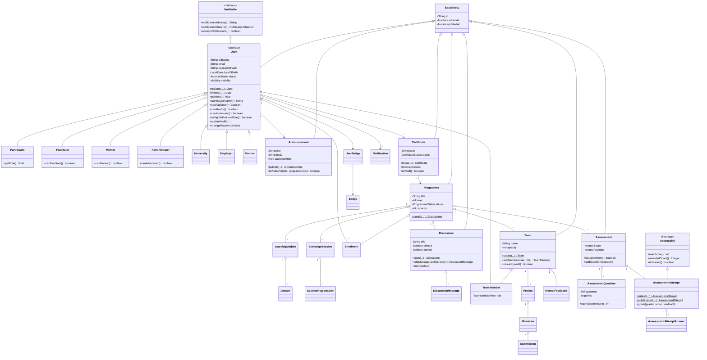
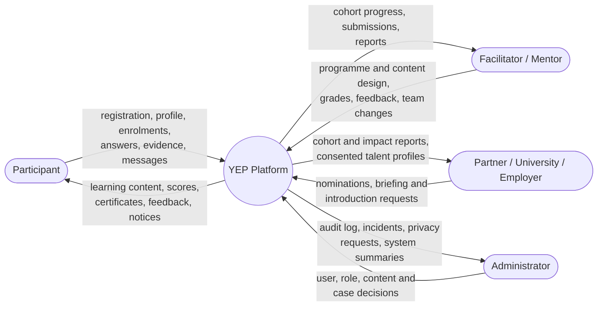
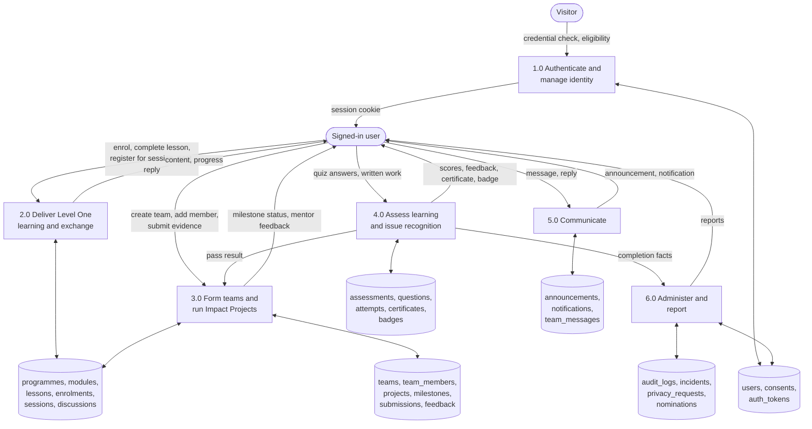
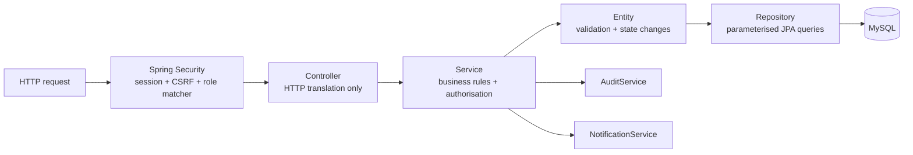

# YEP architecture diagrams

All diagrams are Mermaid source. Paste into any Mermaid renderer (mermaid.live, GitHub, VS Code,
Notion) to export PNG/SVG/PDF.

---

## 1. UML use case diagram

```mermaid
flowchart LR
    Youth([Youth participant 18-35])
    Fac([Facilitator])
    Men([Mentor])
    Uni([University / training partner])
    Emp([Employer])
    Part([Partner organisation])
    Adm([Administrator])

    subgraph YEP[Youth Empowerment Project]
        UC1((Register and manage profile<br/>with 18-35 eligibility))
        UC2((Log in / reset password))
        UC3((Enrol in a programme))
        UC4((Follow Level One learning<br/>modules and lessons))
        UC5((Attend exchange sessions))
        UC6((Take part in discussions))
        UC7((Read announcements))
        UC8((Form and join a Level Two team))
        UC9((Submit Impact Project<br/>and evidence))
        UC10((Review project and<br/>give mentor feedback))
        UC11((Take assessments))
        UC12((Grade assessments))
        UC13((Receive certificate and badge))
        UC14((Verify a certificate<br/>publicly))
        UC15((Manage users and roles))
        UC16((Manage programmes, sessions<br/>and content))
        UC17((Publish announcements))
        UC18((View reports))
        UC19((Handle safety incidents<br/>and privacy requests))
        UC20((Nominate learners))
        UC21((Browse consent-based<br/>talent showcase))
    end

    Youth --> UC1
    Youth --> UC2
    Youth --> UC3
    Youth --> UC4
    Youth --> UC5
    Youth --> UC6
    Youth --> UC7
    Youth --> UC8
    Youth --> UC9
    Youth --> UC11
    Youth --> UC13

    Fac --> UC2
    Fac --> UC7
    Fac --> UC16
    Fac --> UC12
    Fac --> UC17
    Fac --> UC18
    Fac --> UC8

    Men --> UC2
    Men --> UC10
    Men --> UC18

    Uni --> UC2
    Uni --> UC20
    Uni --> UC18

    Emp --> UC2
    Emp --> UC21

    Part --> UC2
    Part --> UC18

    Adm --> UC2
    Adm --> UC15
    Adm --> UC16
    Adm --> UC17
    Adm --> UC18
    Adm --> UC19

    Anyone([Any visitor]) --> UC14
```

---

## 2. UML class diagram (domain model)

---

## 3. ER diagram (core tables)

```mermaid
erDiagram
    USERS ||--o{ USER_INTERESTS : has
    USERS ||--o{ USER_SKILLS : has
    USERS ||--o{ CONSENTS : grants
    USERS ||--o{ AUTH_TOKENS : owns
    USERS ||--o{ ENROLMENTS : enrols
    USERS ||--o{ SESSION_REGISTRATIONS : registers
    USERS ||--o{ TEAM_MEMBERS : joins
    USERS ||--o{ ASSESSMENT_ATTEMPTS : submits
    USERS ||--o{ CERTIFICATES : earns
    USERS ||--o{ USER_BADGES : receives
    USERS ||--o{ NOTIFICATIONS : receives
    USERS ||--o{ ANNOUNCEMENTS : authors
    USERS ||--o{ DISCUSSION_MESSAGES : writes

    PROGRAMMES ||--o{ LEARNING_MODULES : contains
    LEARNING_MODULES ||--o{ LESSONS : contains
    PROGRAMMES ||--o{ ENROLMENTS : offers
    PROGRAMMES ||--o{ EXCHANGE_SESSIONS : schedules
    EXCHANGE_SESSIONS ||--o{ SESSION_REGISTRATIONS : receives
    PROGRAMMES ||--o{ DISCUSSIONS : hosts
    DISCUSSIONS ||--o{ DISCUSSION_MESSAGES : contains
    PROGRAMMES ||--o{ TEAMS : groups
    PROGRAMMES ||--o{ ASSESSMENTS : assesses
    PROGRAMMES ||--o{ CERTIFICATES : certifies
    PROGRAMMES ||--o{ ANNOUNCEMENTS : targets

    TEAMS ||--o{ TEAM_MEMBERS : has
    TEAMS ||--o{ TEAM_MESSAGES : contains
    TEAMS ||--|| PROJECTS : owns
    PROJECTS ||--o{ MILESTONES : plans
    PROJECTS ||--o{ PROJECT_RESOURCES : stores
    MILESTONES ||--o{ SUBMISSIONS : receives
    TEAMS ||--o{ MENTOR_FEEDBACK : receives

    ASSESSMENTS ||--o{ ASSESSMENT_QUESTIONS : contains
    ASSESSMENT_QUESTIONS ||--o{ ASSESSMENT_QUESTION_OPTIONS : offers
    ASSESSMENTS ||--o{ ASSESSMENT_ATTEMPTS : records
    ASSESSMENT_ATTEMPTS ||--o{ ASSESSMENT_ATTEMPT_ANSWERS : captures

    BADGES ||--o{ USER_BADGES : awarded_as

    USERS {
        char id PK
        varchar full_name
        varchar email UK
        varchar password_hash
        varchar role
        varchar status
        date date_of_birth
        datetime joined_at
    }
    PROGRAMMES {
        char id PK
        varchar title
        int level
        varchar status
        int capacity
        char facilitator_id FK
    }
    TEAMS {
        char id PK
        char programme_id FK
        varchar name UK
        char mentor_id FK
        int capacity
    }
    TEAM_MEMBERS {
        char team_id PK
        char user_id PK
        varchar role
    }
    PROJECTS {
        char id PK
        char team_id FK
        varchar title
        varchar status
    }
    ASSESSMENTS {
        char id PK
        char programme_id FK
        varchar type
        int max_score
        int max_attempts
        datetime due_at
    }
    ASSESSMENT_ATTEMPTS {
        char id PK
        char assessment_id FK
        char user_id FK
        int attempt_no
        varchar status
        int score
    }
    CERTIFICATES {
        char id PK
        char programme_id FK
        char participant_id FK
        varchar code UK
        varchar status
        datetime issued_at
    }
    ANNOUNCEMENTS {
        char id PK
        char author_id FK
        char programme_id FK
        varchar audience_role
        varchar title
        datetime published_at
    }
    DISCUSSIONS {
        char id PK
        char programme_id FK
        char author_id FK
        varchar title
        boolean locked
    }
```

---

## 4. Data Flow Diagram — Level 0 (context)

---

## 5. Data Flow Diagram — Level 1

---

## 6. Request flow (layered architecture)

